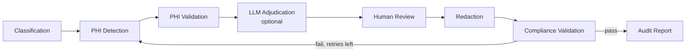

# PHI De-identification & Compliance Workflow

A LangGraph multi-agent system that detects, redacts and audits Protected Health Information (PHI) in clinical documents. It auto-redacts what it is confident about, asks a human about what it is not, then checks its own output before producing an audit report.

**Live demo:** [phi-deidentification.streamlit.app](https://phi-deidentification.streamlit.app/) (no sign-up needed)

Team capstone project (six members, see [Team](#team)), IITM Pravartak Advanced Certification in Agentic AI.

---

## Why this exists

- Lab reports, pathology reports and discharge summaries carry many HIPAA Safe Harbor identifiers: names, dates of birth, MRNs, phone and account numbers.
- **Under-redaction** leaks patient data. **Over-redaction** destroys the document's clinical value.
- Manual review does not scale, so this system does the first pass automatically and routes only uncertain cases to a person.

## Results at a glance

| Metric | Value |
|---|---|
| Labeled test documents | **350** (7 clinical document types, 50 each) |
| Labeled PHI spans | **2,150+** |
| Overall F1 (overlap match) | **0.6587** |
| Recall | **0.9949** (2,139 of 2,150 spans found; 11 misses, all dates) |
| Precision | 0.4923 (understated: many "false positives" are real entities outside the label set) |
| Human review on vs off | **+0.0411 F1**, so the review step measurably helps |
| Bugs found and fixed through testing | **9**, each with root cause and verified fix |

Every number comes from a real run of the evaluation scripts in `eval/`, not an estimate.

---

## How it works



| Agent | What it does |
|---|---|
| **ClassificationAgent** | Identifies the document type. Heuristic by default; optional GPT-4o-mini with retrieval-augmented few-shot examples |
| **PHIDetectionAgent** | Finds PHI using Microsoft Presidio + spaCy plus custom recognizers (MRN, accession, account, claim numbers, header names) |
| **PHIValidationAgent** | Schema and completeness check on what was detected |
| **LLMAdjudicationAgent** | Optional. Reviews only ambiguous spans using tool calling + structured output; defers to a human if unsure |
| **HumanReviewAgent** | Pauses the workflow for low-confidence spans and waits for approve / reject |
| **RedactionAgent** | Replaces approved PHI spans in the text |
| **ComplianceValidationAgent** | Re-scans the redacted output; loops back to detection if PHI remains (max 2 retries) |
| **AuditReportAgent** | Produces the compliance score, per-category checks and audit log |

### Key design choices

- **Real pause and resume:** LangGraph `interrupt()` stops the run for human review. A **SQLite checkpointer** lets a paused review survive a server restart.
- **Per-type confidence thresholds:** reliable regex types auto-redact at 0.6; noisier types like names and dates need 0.8 to 0.85 before skipping human review.
- **Always terminates:** if retries run out, deterministic types auto-redact and only ambiguous ones get one final human review.
- **PHI never leaves the machine unmasked:** before any OpenAI call, a regex pass masks names, SSNs, phones, emails and MRNs.
- **Safe by default:** every PHI endpoint needs an API key; errors never echo document content back; the audit store saves placeholders, not PHI text.

---

## Tech stack

- **Orchestration:** LangGraph, LangChain Core
- **PHI detection:** Microsoft Presidio, spaCy (`en_core_web_lg`)
- **Optional LLM:** OpenAI GPT-4o-mini
- **Backend:** FastAPI (REST + Server-Sent Events streaming)
- **Frontend:** Streamlit
- **Storage:** SQLite (checkpoints), SQLAlchemy (audit trail)
- **Testing:** pytest
- **Python:** 3.11

---

## Run it locally

You need **Python 3.11** and **Git** installed. Run these in a terminal.

**1. Get the code**

```bash
git clone https://github.com/pujitha-vasanth/phi-deidentification-agent.git
cd phi-deidentification-agent
```

**2. Create a virtual environment and install packages**

```bash
python -m venv .venv
source .venv/bin/activate        # Windows: .venv\Scripts\activate
pip install -r requirements.txt
python -m spacy download en_core_web_lg
```

**3. Set up your settings file**

```bash
cp .env.example .env
```

The defaults work as is. `PHI_DEID_API_KEY=dev-local-key` is the key you will use in the UI. Add an `OPENAI_API_KEY` only if you want the optional LLM features.

**4. Start the API** (terminal 1)

```bash
uvicorn api.main:app --reload --port 8000
```

**5. Start the UI** (terminal 2, with the virtual environment activated)

```bash
streamlit run app/streamlit_app.py
```

Open `http://localhost:8501`, enter `dev-local-key` in the sidebar, then paste text or upload a `.txt`, `.pdf` or `.docx` file.

---

## Optional LLM features

Both are off by default so the project runs free and gives repeatable results. Turn them on in `.env`:

| Setting | Effect |
|---|---|
| `PHI_DEID_CLASSIFICATION_BACKEND=llm` | GPT-4o-mini classifies the document type, with automatic fallback to the heuristic on failure |
| `PHI_DEID_ADJUDICATION_BACKEND=llm` | GPT-4o-mini reviews ambiguous spans before they reach a human |

Both need `OPENAI_API_KEY` set.

---

## API endpoints

All endpoints except `/health` need the header `X-API-Key`.

| Endpoint | Purpose |
|---|---|
| `POST /redact` | Redact raw text |
| `POST /redact/upload` | Redact an uploaded file |
| `POST /redact/batch` | Redact up to 50 documents in one request |
| `POST /redact/resume` | Send human review decisions and continue a paused run |
| `POST /redact/stream` (and `/upload/stream`, `/resume/stream`) | Same as above, with live progress events |
| `GET /records`, `GET /records/{id}/audit` | Read the stored audit trail |
| `GET /health` | Real readiness check |

Example:

```bash
curl -X POST http://localhost:8000/redact \
  -H "Content-Type: application/json" \
  -H "X-API-Key: dev-local-key" \
  -d '{"text": "Patient Mr. John Carter, MRN: MR-88213, seen 07/10/2026.", "filename": "note.txt"}'
```

---

## Tests and evaluation

```bash
pytest -q                                   # full test suite
python -m eval.evaluate --backend presidio  # precision / recall / F1
python -m eval.ablation_study               # human review on vs off
python -m eval.error_analysis               # real false positive / negative examples
```

Results also show up in the UI under **View > Evaluation dashboard**.

### Dataset

The standard n2c2 2014 benchmark was unavailable, so the team built a reproducible alternative:

- **Real clinical structure:** Kaggle "Medical Transcriptions" dataset (CC0), 7 document types
- **Exact ground truth:** a Faker-based injector adds labeled PHI and records the exact character position of every value

---

## Project structure

```
agents/         the 8 LangGraph agents
graph/          workflow wiring and shared state
api/            FastAPI backend
app/            Streamlit UI
ingestion/      .txt / .pdf / .docx text extraction
storage/        persistent audit trail
eval/           evaluation, ablation and error analysis scripts + results
scripts/        dataset and demo file generators
tests/          pytest suite
data/           sample documents
```

---

## Known limitations

- Evaluated on synthetic data only, not real clinical notes
- Confidence thresholds are hand-picked, not statistically calibrated
- No clinical-domain NER fine-tuning (for example scispaCy) yet
- SQLite checkpointer limits deployment to a single process
- Rare identifiers such as vehicle and device IDs are not covered
- No monitoring or drift detection; evaluation runs on demand

---

## Team

Group 9: **Ramya Priyanka A, Komal Arora, Pujitha Vasanth, Sandeep R, Shourya NS, Twisha Patel**

For the full technical reference (every design decision, bug write-up and deployment path), see the [detailed README in the main repository](https://github.com/Ramya192/phi-deidentification#readme).


